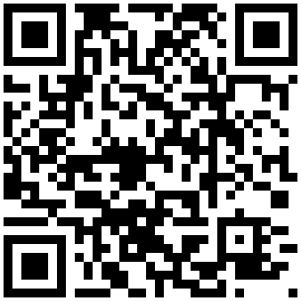

# Macro Diary

A small food and weight diary that runs entirely on your iPhone as a home-screen web app.
Log meals by tapping or by dictating, see calories, protein, carbs and fat add up as you go, and copy yesterday's meals in one tap.
No account, no server, no sync: your data stays in the phone's browser storage, with a JSON export for backups.

## Install on iPhone



1. Scan the code with the iPhone camera, or open https://balupremkumar.github.io/macro-diary/ in Safari.
2. Tap the Share button.
3. Tap Add to Home Screen, then Add.

It opens full screen from the home screen and works without signal after the first visit.
Nothing to trust or install beyond that: the page is served over HTTPS by GitHub Pages.

## Using it

- Weigh in: the top row of the Diary is ready to type each morning, prefilled with your last weight.
- Dictate: tap Dictate, tap the microphone on the iPhone keyboard and say what you ate, for example "Meal one, 2 Weet-Bix, green milk 200 mils and one scoop of whey. Meal two, chicken breast 125 grams, basmati rice 150 grams. Save."
- Copy: an empty day offers to copy your last logged day; each meal can be copied from an earlier day.
- Foods: add the foods you actually eat, with the other names you might say, so dictation recognises them.
- Backup: Settings, Export backup, then save the file to Files or iCloud Drive.

## Develop

Plain HTML, CSS and ES modules; no build step and no runtime dependencies.
Serve the folder with any static server, for example `python -m http.server 8137`, and open http://127.0.0.1:8137/.

```
npm test                      # unit tests (Node's built-in runner)
cd e2e && npm install && npx playwright install webkit
npx playwright test           # end-to-end tests in WebKit at iPhone 15 size
```

## Licence

MIT. Schibsted Grotesk is used under the SIL Open Font License (fonts/OFL.txt).
